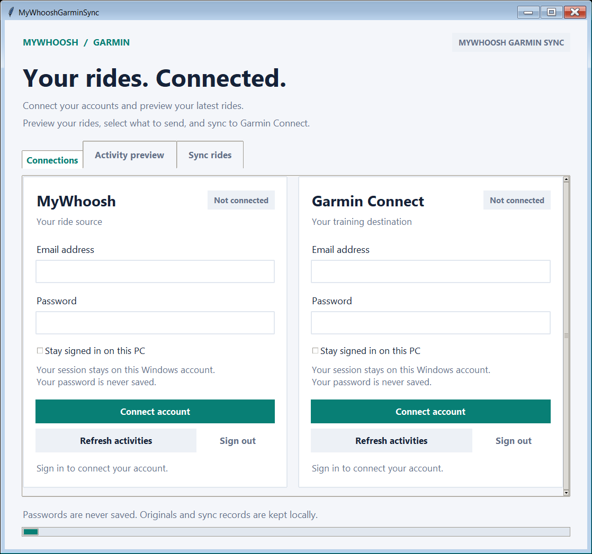
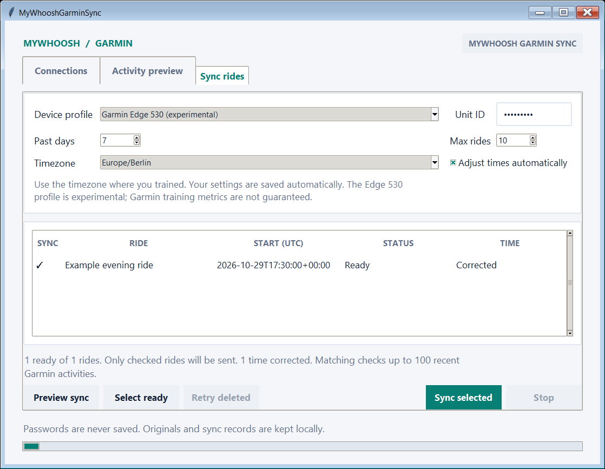

# MyWhooshGarminSync

Bring your MyWhoosh rides into Garmin Connect without repeatedly downloading,
preparing and uploading FIT files by hand.

The goal is a Windows app that anyone can use: sign in through a simple window,
then double-click after a workout to sync. Each person uses their own accounts
and device settings.

## Current status

**Early development: Windows test EXE, source app and Linux CLI available.**

The local Windows build is `dist/MyWhooshGarminSync.exe`. Copy it into a writable
Windows folder and double-click it; Python is included. See the
[Windows guide](docs/windows-build.md) for setup and rebuilding.

- Use the [desktop app](docs/desktop.md) to connect accounts and sync selected rides (requires Tk).
- Preview a bounded date range, select rides and confirm the upload to Garmin.
- Automatically correct known MyWhoosh time errors, with changes shown before upload.
- List MyWhoosh rides, download FIT files and validate them without changing originals.
- Compare a FIT file with recent Garmin activities and explicitly confirm a single upload.
- Optionally create a separate FIT copy using an experimental Edge 530 device profile.

Real-account tests confirmed download and import. Training Effect appeared after
an Edge 530 profile import in one manual test; training load and overall training
status are not guaranteed. The app uses unofficial provider interfaces.

**Why time correction is needed:** In an inspected MyWhoosh export, timestamps
matched the rider's local clock even though FIT defines those fields as UTC.
Interpreting them as UTC shifts the displayed ride times. Corrections must use
the selected timezone and the workout date's daylight saving rules, while
preserving the original FIT file.

**Adjust times automatically** is enabled by default. Choose your workout timezone
once; the app converts affected MyWhoosh recordings to UTC and repairs their finish
times. **Sync selected** shows the changes before upload. Uncheck the option to
keep original times. Measurements and durations are preserved. See the [sync guide](docs/sync.md).

## Using the Windows app

1. **Open the app.** Put `MyWhooshGarminSync.exe` in a writable local folder and
   double-click it. No Python installation is needed.
2. **Connect your accounts.** In **Connections**, sign in to MyWhoosh and Garmin.
   Optionally select **Stay signed in on this PC** and enter a Garmin verification
   code if requested.
3. **Set up your device.** Open **Sync rides**. If you own an Edge 530, select
   **Garmin Edge 530 (experimental)** under **Device profile** and enter its **Unit ID**.
   On your Edge, find it under **Menu → Settings → System → About → Copyright Info**
   ([Garmin's instructions](https://www8.garmin.com/manuals/webhelp/edge530/EN-GB/GUID-5B96B8E4-1A8A-498A-B3BA-926D3A40E171.html)).
   Use your own device's numeric ID. To preserve the original device information,
   select **Keep original device** instead.
4. **Choose your timezone.** Select where you trained, for example `Europe/Berlin`.
   Leave **Adjust times automatically** checked to correct affected MyWhoosh times.
   Adjust **Past days** and **Max rides** if needed.
5. **Preview your rides.** Click **Preview sync**. Nothing is uploaded yet.
   The newest ready ride is checked automatically; use the **SYNC** column to
   select other rides, or **Select ready** to select all ready rides.
6. **Sync.** Click **Sync selected**, review any time corrections and confirm.
   Wait for confirmation that the selected rides were imported into Garmin Connect.

Device settings are remembered. After your next workout, open the app, preview
and sync. Automatic time adjustment starts enabled on every launch. When replacing
the EXE, keep its existing `data` folder.

<details>
<summary>App screenshots (example data)</summary>

**Connections** — sign in to both services.



**Sync rides** — configure your device and timezone, preview, then sync.



These screenshots use example data and contain no personal account details.

</details>

## Quick start for developers

Requires Python 3.12+. The full dependency set has been tested on Linux x86_64.
Run from the repository directory, without `sudo`:

```bash
python3 -m venv .venv
.venv/bin/python -m pip install --only-binary=:all: -r requirements-garmin.lock
.venv/bin/python -m pip install --no-deps --no-build-isolation -e '.[test,garmin]'
.venv/bin/mywhoosh-sync activities --interactive --limit 10
```

Enter credentials in your own terminal when prompted. This command only lists
rides; it does not save the session or upload anything. CLI prompts are currently
in German.

See the [CLI guide](docs/cli.md) for download, device configuration and upload commands.

## Data and safety

- Data goes directly to MyWhoosh / its download storage and Garmin over HTTPS;
  there is no project relay server or implemented telemetry.
- Passwords are not saved. Standard interactive commands keep sessions in memory;
  optional Windows session storage is available through the new account commands.
- Original FIT files are preserved. Uncertain uploads are recorded and block
  resending through durable source-ID tracking and file upload records.
- Personal configuration, FIT files and upload journals are excluded from Git.
  FIT files and upload journals are not encrypted; Git exclusions do not prevent access
  by other programs running as you or inclusion in backups.

**If an upload result is unclear, check Garmin Connect before doing anything else.
Do not delete its local upload record to retry.** Recent-activity matching cannot
rule out older duplicates.

## Next steps

The [shared sync workflow](docs/sync.md), desktop UI and Windows session storage
are implemented. Native Windows tests and the packaged EXE's offline startup check
pass. Next: user-run validation of real sign-in, remembered sessions and sync.

## Development checks

```bash
.venv/bin/python -m pytest
.venv/bin/python -m pip check
```

Tests use synthetic data and block real network requests.

## License

Licensed under the [MIT License](LICENSE). Third-party components retain their own licenses.
